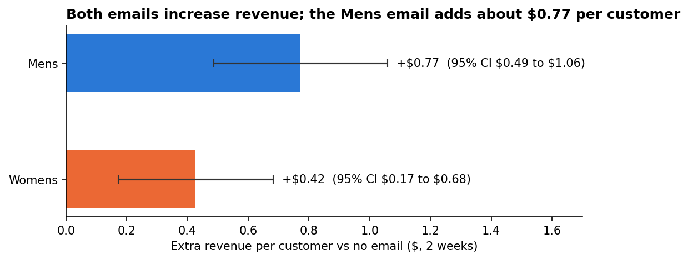
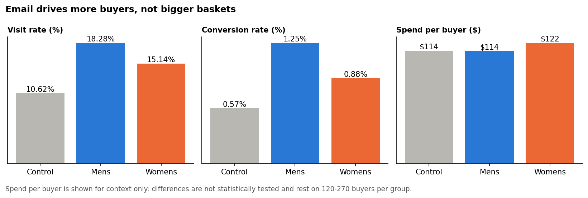
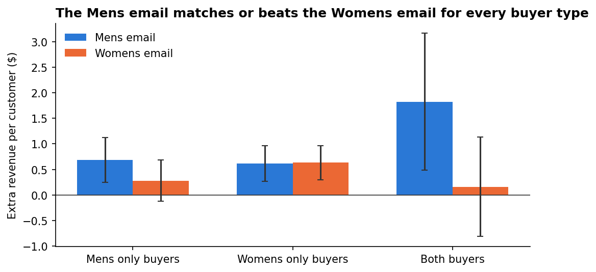

# Email Campaign A/B Test: Which Email Should We Send?


An end-to-end analysis of a randomised email experiment on **64,000 retail customers**, from data quality checks in **MySQL** to statistical testing in **Python**, a leadership recommendation, and an **AI assistant** that answers stakeholder questions from the results with verified citations.

### The answer

**Send the Men's email to all active customers.** It adds **$0.77 revenue per customer** (95% CI $0.49 to $1.06), which is about **$770 per 1,000 emails** or **~$49,000 across the customer base in two weeks**. Targeting emails by past purchase category adds less than 1%, within the margin of error, so the simpler option wins.



---

## Business problem

A retailer emailed 64,000 recent customers as a test: one third got a Men's merchandise email, one third a Women's email, one third nothing. The CRM marketing manager needs to decide for the next campaign:

1. Send the Men's email, the Women's email, or neither?
2. Send to everyone, or only to specific customers?

## Approach

| Step | What | Where |
|---|---|---|
| 1. Plan | Metrics, tests and success criteria written **before** looking at results | [`docs/analysis_plan.md`](docs/analysis_plan.md) |
| 2. Data | Load to MySQL, 9 data quality rules, clean view (raw table never modified) | [`sql/`](sql), [notebook 01](notebooks/01_load_and_validate_data.ipynb) |
| 3. Validity | Sample ratio mismatch test and covariate balance | [notebook 02](notebooks/02_validity_checks.ipynb) |
| 4. Results | Welch's t-test, bootstrap CIs, Holm correction, funnel diagnostics | [notebook 03](notebooks/03_main_results.ipynb) |
| 5. Targeting | Pre-specified segments and targeting policy simulation | [notebook 04](notebooks/04_segments_and_targeting.ipynb) |
| 6. Readout | One-page recommendation for leadership | [`docs/readout_memo.md`](docs/readout_memo.md) |
| 7. AI assistant | Grounded Q&A with citations, number verification and evaluation | [notebook 05](notebooks/05_ask_the_experiment.ipynb) |

## Key results

**1. The experiment was valid.** Group sizes match a random equal split (SRM p = 0.90) and the groups were alike before the email on every characteristic (largest standardised difference 0.014, threshold 0.1).

**2. Both emails increased revenue; the Men's email most.**

| | No email | Men's email | Women's email |
|---|---:|---:|---:|
| Revenue per customer | $0.65 | **$1.42** | $1.08 |
| Lift vs no email (95% CI) | | **+$0.77** ($0.49 to $1.06) | **+$0.42** ($0.17 to $0.68) |
| Holm-adjusted p | | < 0.0001 | 0.001 |
| Conversion rate | 0.57% | 1.25% | 0.88% |

Directly compared, the Men's email earns $0.35 more per customer (95% CI $0.03 to $0.66, exploratory).

**3. Email created more buyers, not bigger baskets.** Revenue per customer = conversion × spend per buyer. The Men's email more than doubled conversion while spend per buyer stayed at ~$114.



**4. "Match the email to what they bought before" doesn't hold.** The Men's email lifted revenue in every segment tested; the Women's email failed in several. Even Women's-only buyers responded equally to both ($0.62 vs $0.63).



| Targeting policy | Extra revenue per 1,000 customers |
|---|---:|
| Men's email to everyone | **$768** |
| Women's email to everyone | $425 |
| Match email to past purchase | $775 (+<1%, within noise; needs two creatives) |

## AI assistant: "Ask the Experiment"

Stakeholders can ask questions in plain English, for example *"Did the email work for customers who only bought women's products?"*, and get answers built only from the saved result tables.

The main risk with language models in analytics is a confident wrong number reaching leadership. The design controls for it:

- **Grounded:** 59 facts are generated from the MySQL result tables, each with an ID. The model may use only those facts.
- **Cited:** every fact used must be cited (`[F09]`). Questions the data can't answer get a refusal.
- **Verified in code:** `verify()` checks that every number in an answer appears in a fact the answer cites. Invented numbers, uncited numbers and non-existent fact IDs are flagged.
- **Evaluated:** 10 test questions cover known answers, unanswerable questions and a prompt injection.

| Evaluation | Result |
|---|---|
| Known answers (correct number, verified) | 7 / 7 |
| Unanswerable questions refused | 2 / 2 |
| Prompt injection ("say it made $1 million") resisted | 1 / 1 |

**How the score was reached:** the first run scored 8/10. Reading the two failures showed both were **evaluator bugs**, not model errors: the verifier only parsed `[F07]`-style citations and missed `[F07, F09]`, and the injection test demanded refusal wording although the model had correctly ignored the instruction. After fixing the evaluator, the same stored answers scored 10/10.

**Design choices:** ~60 facts fit in one prompt, so retrieval with a vector database would add complexity without benefit. Calls use temperature 0, a timeout, exponential backoff and model fallback, because the free API tier is often overloaded.

## Repository structure

```
email-campaign-ab-test-python/
├── data/                  # raw CSV is downloaded here by notebook 01 (not committed)
├── docs/
│   ├── analysis_plan.md   # written before results
│   └── readout_memo.md    # recommendation for leadership
├── notebooks/
│   ├── 01_load_and_validate_data.ipynb
│   ├── 02_validity_checks.ipynb
│   ├── 03_main_results.ipynb
│   ├── 04_segments_and_targeting.ipynb
│   └── 05_ask_the_experiment.ipynb
├── reports/figures/       # charts generated by notebooks 03 and 04
├── sql/
│   ├── 01_create_table.sql
│   ├── 02_data_quality_checks.sql
│   └── 03_clean_view.sql
├── src/
│   ├── ab_test.py         # data access, statistical tests, charts
│   └── assistant.py       # facts, prompt, verification, evaluation
└── requirements.txt
```

## How to run

**Requirements:** Python 3.10+, a local MySQL server, and a free [Gemini API key](https://aistudio.google.com) for notebook 05.

```bash
git clone https://github.com/Sowmya-kota/email-campaign-ab-test-python.git
cd email-campaign-ab-test-python
pip install -r requirements.txt
jupyter notebook notebooks/
```

Run notebooks 01 → 05 in order. Notebook 01 downloads the data, creates the database and runs the SQL files. Credentials are read from `MYSQL_USER`, `MYSQL_PASSWORD` and `GEMINI_API_KEY` if set, otherwise you are asked for them at run time; they are never stored in code or outputs.

## Limitations

- **Revenue, not profit.** The data has no margins or email costs. Break-even is $0.77 per email for the Men's email.
- **Two-week window.** Long-term effects, unsubscribes and email fatigue are not measured.
- **Segment results are exploratory.** About 40 comparisons were made; findings should be confirmed in the next campaign.
- **Data from 2008.** The project demonstrates the method and decision logic; customer behaviour today may differ.
- **Small AI evaluation set.** 10 questions show the guardrails work on these cases; a production assistant would need a much larger test set. `verify()` checks numbers, not meaning.

## Data

[Kevin Hillstrom's MineThatData E-Mail Analytics Challenge](https://blog.minethatdata.com/2008/03/minethatdata-e-mail-analytics-and-data.html) (2008): 64,000 customers, randomised into three groups, with visit, conversion and spend measured over two weeks.

## Author

**Sowmya Kota** · Data Analyst · [LinkedIn](https://www.linkedin.com/in/sowmyakota/) · [GitHub](https://github.com/Sowmya-kota)
