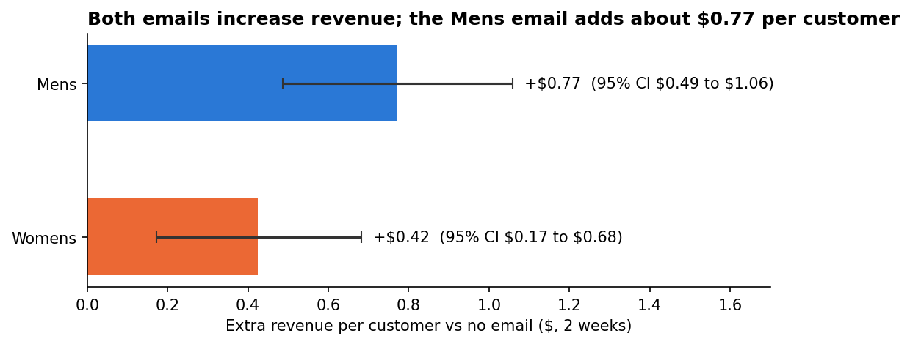
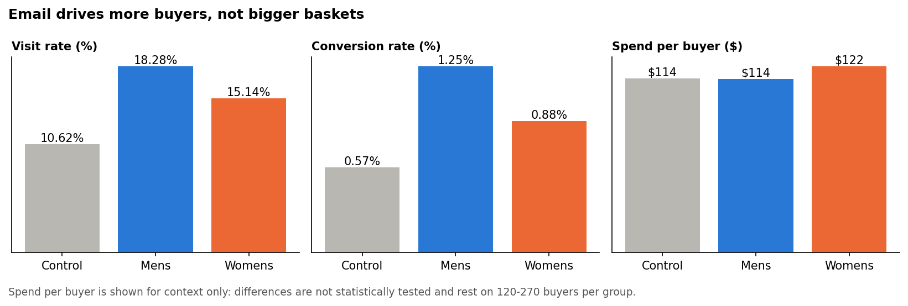
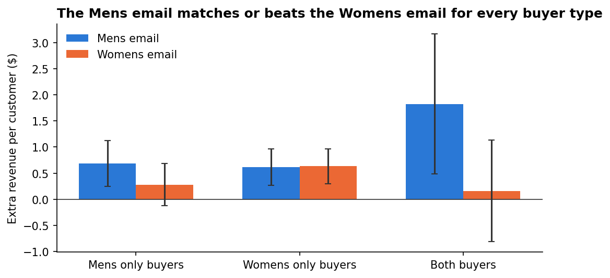

# Email Campaign Test: Readout

**To:** Priya, CRM Marketing Manager · **From:** Sowmya Kota, Analytics · **Decision needed:** email strategy for the next campaign

## Recommendation

**Send the Men's email to all active customers.**

- **Both emails increased revenue, and the Men's email increased it most:** about **+$0.77 per customer** over two weeks, more than double the no-email group.
- **Expected impact:** about **$770 extra revenue per 1,000 emails**. Across our 64,000 active customers, that is roughly **$49,000 in two weeks** (likely range $31,000 to $68,000).
- **Targeting by past purchase category does not pay off.** Sending the Women's email to Women's-only buyers adds less than 1% over sending everyone the Men's email, which is within the margin of error. The simpler option is the right one.

## What we tested

64,000 customers who bought in the last 12 months were randomly split into three equal groups: Men's email, Women's email, and no email. We tracked visits, purchases and spend for two weeks. Metrics, tests and success criteria were agreed **before** looking at results ([analysis plan](analysis_plan.md)).

## Results

| | No email | Men's email | Women's email |
|---|---:|---:|---:|
| Revenue per customer | $0.65 | **$1.42** | $1.08 |
| Lift vs no email | | **+$0.77** (95% CI +$0.49 to +$1.06) | **+$0.42** (95% CI +$0.17 to +$0.68) |
| Conversion rate | 0.57% | 1.25% | 0.88% |
| Visit rate | 10.6% | 18.3% | 15.1% |

Both emails meet the success criteria agreed in advance (statistically significant after correcting for two comparisons, and the confidence interval is entirely above $0). The Men's email also beat the Women's email directly, by **+$0.35 per customer** (95% CI +$0.03 to +$0.66), though the size of that gap is uncertain.

## Why it worked

The emails brought **more customers to buy**, not bigger baskets. The Men's email more than doubled conversion (0.57% → 1.25%) while spend per buyer stayed about the same (~$114).

## Who to target

The Men's email increased revenue in **every** customer segment we checked (past purchase category, recency, channel, area, new vs existing). The Women's email worked only in some segments. Even among customers who had only ever bought women's products, the Men's email performed as well as the Women's email.

| Targeting policy | Extra revenue per 1,000 customers |
|---|---:|
| Men's email to everyone | **$768** |
| Women's email to everyone | $425 |
| Match email to past purchase category | $775 |

## Next steps

1. **Roll out the Men's email to all active customers**, keeping a small random no-email group (e.g. 10%) so we keep measuring the real effect.
2. **Find out what made the Men's email work.** Women's-only buyers responded to it as well as to the Women's email, which suggests the content, offer or subject line mattered more than the product category. Test those elements next.
3. **Measure profit and email fatigue.** Track margin, unsubscribes and complaints, and look beyond two weeks.

## Confidence and caveats

- **The test was run correctly.** Group sizes matched the planned equal split (p = 0.90), and the three groups were alike before the email on every customer characteristic (largest standardised difference 0.014, well under the 0.1 threshold).
- **These are revenue figures, not profit.** Product margins and email costs are not in the data. Break-even is $0.77 per email for the Men's email, far above typical email sending costs.
- **Short window:** two weeks only; longer-term effects are not measured.
- **Segment results are exploratory.** Many comparisons were made, so single segment results should be confirmed in the next campaign.
- **The data is from 2008.** It shows the method and the decision logic; customer behaviour today may differ.

*Methods: Welch's t-test with bootstrap confidence intervals for revenue (spend is mostly zeros and skewed), two-proportion z-tests for rates, Holm correction for multiple comparisons. Full analysis in the project notebooks.*
